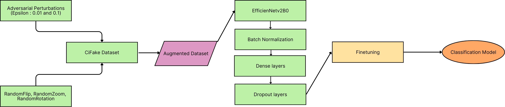

# Task 1 - Image Classification

## Overview
The rise of advanced generative models like Stable Diffusion and Adobe Firefly has made distinguishing real from AI-generated images increasingly crucial. Task 1 aims to develop a model capable of accurately classifying images while handling adversarial perturbations. This is essential for ensuring content authenticity and combating misinformation in digital media.

## Objective
- **Task 1:** Develop a model that accurately identifies AI-generated images, particularly those created using advanced diffusion techniques.

Our team has fine-tuned the EfficientNet-V2B0 model, incorporating the latest advancements in Deep Learning, to develop solutions that enhance the reliability and trustworthiness of digital media.

## Our Approach
We fine-tuned the EfficientNet-V2B0 model by adding some additional layers for Task 1, leveraging its efficiency and accuracy. The CIFAKE dataset, augmented with additional real and synthetic images and perturbed images was used for training for adversarial training and data augmentation enhanced robustness against perturbations. The model was evaluated using accuracy, precision, recall, and F1 score, ensuring reliability under real-world conditions. Optimizations were applied to minimize latency, making the solution both robust and efficient for detecting AI-generated images.



## File Structure

Your directory should look like this after extracting the zip file:
```
Task_1/
├── data
|   ├── test
|   ├── train
├── inference_script.py
├── EfficientNet_net.pkl
├── EfficientNet_training_script.ipynb
```

`data` - Contain dataset used for training

`inference_script.py` - Predict the class (`real` or `fake`) of image

`EfficientNet_model.pkl` - Model save file

`EfficientNet_training_script.ipynb` - Script used for training the model

## Steps to Run Task 1

- Install all required Python libraries:
  ```bash
  pip install -r requirements.txt
  ```
  or
  ```
  pip install xgboost Pillow scikit-image opencv-python matplotlib joblib torchvision huggingface_hub
  ```
- Place the models in the directories specified in the script:
     `EfficientNet_model.pkl`


- Open the task 1 directory in command line
  `cd`


- replace `path\to\your\image.jpg` with your image path
  ```
  python inference_script.py path\to\your\image.jpg
  ```

## Troubleshooting
- **Model Loading Errors:** Verify that model files are correctly placed and named.
- **Visualization Issues:** Ensure OpenCV and Matplotlib are properly installed.

## Results
- F1 Score - `95.56%`
- Recall - `97.93%`
- Precision - `93.31%`
