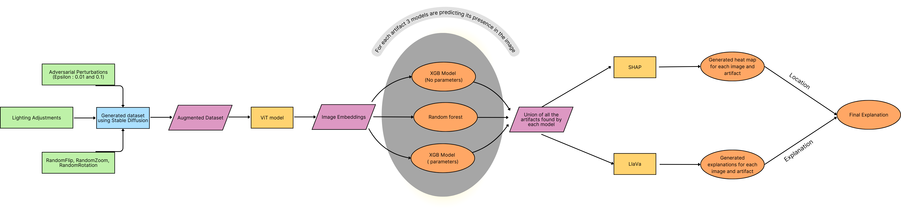
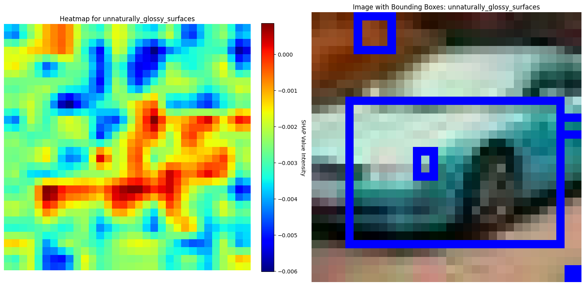

# Task 2 - Artifact Detection and Explanation

## Overview
Advanced generative models like Stable Diffusion and Adobe Firefly often introduce subtle artifacts that differentiate AI-generated images from real ones. Task 2 focuses on identifying these artifacts and generating concise explanations to support classification decisions. This enhances transparency, aids in combating misinformation, and builds trust in AI-driven content verification systems.

## Objective
- **Task 2:** Create a model that not only detects synthetic images but also identifies and explains the specific artifacts that differentiate them from real images.

Our team has leveraged the latest advancements in Deep Learning and Explainable AI to address these tasks, providing solutions that ensure the reliability and trustworthiness of digital media.

## Our Approach
We designed a robust pipeline to identify and explain artifacts in AI-generated images. First, we use a pre-trained Vision Transformer (ViT) to extract image features, which are analyzed by pre-trained models like XGBoost and Random Forest to detect artifacts. For each detected artifact, the LLaVA model generates concise explanations describing its characteristics. SHAP-based heatmaps visualize the artifact locations, and bounding boxes provide precise localization. The results, including artifact names, explanations, and locations, are structured in a JSON format for clarity and ease of interpretation. This approach ensures accurate artifact detection while enhancing explainability and transparency.



## File Structure

Your directory should look like this after extracting the zip file:
```
Task_2/
├── data
|   ├── artifacts
|   |   ├── Abruptly cut-off objects
|   |   ├── Aliasing along high-contrast edges
|   |   ├── and 68 more...
├── models
|   ├── rf_models-20241126T171044Z-001
|   ├── xgb_model_params
|   ├── xgb_models-no_params
├── training_pipelines
|   ├── rf_training
|   ├── XGB_no_params_training
|   ├── XGB_params_training
├── ai-image-artifacts.txt
├── datasetGenerator.ipynb
├── inference_script_task2.py
```

`data` - Contain dataset used for training

`inference_script_task2.py` - Detect artifact and generate explana

`models` - It contains save files of all models trained

`training_pipelines` - Python script used for training the models

`datasetGenerator` - Python script used for generating training data

## Steps to Run Task 2

### 1. Install Dependencies
- Ensure the required libraries are installed. Use the following command:
  ```bash
  pip install -r requirements.txt
  ```
  or
  ```
  pip install transformers torch torchvision shap xgboost scikit-image matplotlib pillow opencv-python huggingface_hub
  ```

### 2. Set Up the Environment
- Ensure GPU availability for faster processing. For platforms like Google Colab, enable GPU support.
- **Authenticate your Hugging Face account**: Replace the placeholder `your_huggingface_token` in the script with your actual Hugging Face API token to enable the LLaVA model.

### 3. Prepare Models and Files
- Place the models in the directories specified in the script:
   - `models\xgb_model_params\xgb_models\`
   - `models\xgb_models-no_params\xgb_models\`
   - `models\rf_models-20241126T171044Z-001\`

### 4. Modify the image path
- Replace `path\to\your\image.jpg` with your image path
  ```
  image_path = "path_to_your_image.png"
  ```

### 5. Run the script
- Execute the script to analyze the image:
  ```
  python inference_script_task2.py
  ```

## Example generated
- An example heatmap and bounding box generated


## Troubleshooting
- **Model Loading Errors:** Verify that model files are correctly placed and named.
- **Visualization Issues:** Ensure OpenCV and Matplotlib are properly installed.
- **API Tokens:** Replace placeholders with valid Hugging Face tokens if required.
