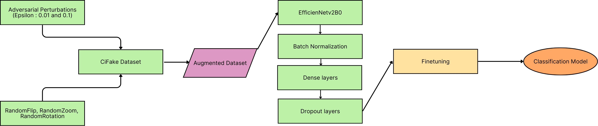
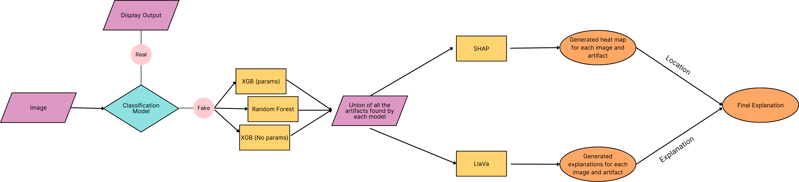

# Adobe - Image Classification and Artifact Identification

## Overview
- This project aims to develop a machine learning solution to address the growing challenges of detecting and explaining AI-generated images. The solution includes two primary tasks:

- Detection of AI-Generated Images: Classify images as real or AI-generated.
- Artifact Identification & Explanation: Identify artifacts in AI-generated images and provide concise explanations for their classification.

The challenge focuses on enhancing transparency in automated image verification systems while maintaining computational efficiency.

## Objectives

### Task 1: Detection of AI-Generated Images
- Classifying images into real or AI-generated.
- Results:
  - F1 Score - `95.56%`
  - Recall - `97.93%`
  - Precision - `93.31%`

### Task 2: Artifact Identification & Explanation
- Identify distinguishing artifacts in AI-generated images and provide human-interpretable explanations.
- Evaluation:
  - Intersection over Union (IoU) for artifact selection.
  - Content similarity with human-annotated explanations, evaluated using GPT-4.

## Our Approach
- Our solution integrates lightweight classification with robust artifact identification and explanation generation:

### Task 1: Image classification
- Model: Fine-tuned EfficientNet-V2B0 for accuracy and low latency.
- Training: Adversarial training on the CIFAKE dataset with augmented perturbations.
- Optimization: Compact architecture ensures real-time, scalable detection.



### Task 2: Artifact Identification & Explanation
- Feature Extraction: Vision Transformer (ViT) to detect fine-grained details.
- Artifact Detection: Ensemble models (XGBoost, Random Forest) identify inconsistencies like unnatural textures and lighting.
- Explanation Generation: LLaVA generates concise, localized explanations with SHAP-based artifact visualization.



## File Structure

Your directory should look like this after extracting the zip file:
```
Codebase/
|   Task_1/
|   ├── data/
|   |   ├── test/
|   |   ├── train/
|   ├── inference_script.py
|   ├── EfficientNet_net.pkl
|   ├── EfficientNet_training_script.ipynb
|   Task_2/
|   ├── data/
|   |   ├── artifacts/
|   |   |   ├── Abruptly cut-off objects/
|   |   |   ├── Aliasing along high-contrast edges/
|   |   |   ├── and 68 more...
|   ├── models
|   |   ├── rf_models-20241126T171044Z-001/
|   |   ├── xgb_model_params/
|   |   ├── xgb_models-no_params/
|   ├── training_pipelines/
|   |   ├── rf_training/
|   |   ├── XGB_no_params_training/
|   |   ├── XGB_params_training/
|   ├── ai-image-artifacts.txt
|   ├── datasetGenerator.ipynb
|   ├── inference_script_task2.py
├── CreatingPerturbations.py
├── pipeline.py
```

- `Task_1` - contain files of task 1
- `Task_2` - contain files of task 2
- `pipeline.py` - Python script to run both tasks combined
- `CreatingPertubations.py` - Python script used to create perturbed images

## Steps to execute pipeline (Both tasks)

### 1. Install Dependencies
- Ensure the required libraries are installed. Use the following command:
  ```bash
  pip install -r requirements.txt
  ```
  or
  ```
  pip install transformers torch torchvision shap xgboost scikit-image matplotlib pillow opencv-python huggingface_hub
  ```

### 2. Set Up the Environment
- Ensure GPU availability for faster processing. For platforms like Google Colab, enable GPU support.
- **Authenticate your Hugging Face account**: Replace the placeholder `your_huggingface_token` in the script with your actual Hugging Face API token to enable the LLaVA model.

### 3. Prepare Models and Files
- Place the models in the directories specified in the script:
   - `Task_1\EfficientNet_model.pkl`
   - `Task_2\models\xgb_model_params\xgb_models\`
   - `Task_2\models\xgb_models-no_params\xgb_models\`
   - `Task_2\models\rf_models-20241126T171044Z-001\`

### 4. Modify the image path
- Replace `path\to\your\image.jpg` with your image path
  ```
  image_path = "path_to_your_image.png"
  ```

### 5. Run the script
- Execute the script to analyze the image:
  ```
  python pipeline.py
  ```
  
## Troubleshooting
- **Model Loading Errors:** Verify that model files are correctly placed and named.
- **Visualization Issues:** Ensure OpenCV and Matplotlib are properly installed.
- **API Tokens:** Replace placeholders with valid Hugging Face tokens if required.
